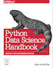

<!--BOOK_INFORMATION-->


*This notebook contains an excerpt from the [Python Data Science Handbook](http://shop.oreilly.com/product/0636920034919.do) by Jake VanderPlas; the content is available [on GitHub](https://github.com/jakevdp/PythonDataScienceHandbook).*

*The text is released under the [CC-BY-NC-ND license](https://creativecommons.org/licenses/by-nc-nd/3.0/us/legalcode), and code is released under the [MIT license](https://opensource.org/licenses/MIT). If you find this content useful, please consider supporting the work by [buying the book](http://shop.oreilly.com/product/0636920034919.do)!*

<!--NAVIGATION-->
< [Data Manipulation with Pandas](03.00-Introduction-to-Pandas.md) | [Contents](Index.md) | [Data Indexing and Selection](03.02-Data-Indexing-and-Selection.md) >

<a href="https://colab.research.google.com/github/jakevdp/PythonDataScienceHandbook/blob/master/notebooks/03.01-Introducing-Pandas-Objects.ipynb"></a>


# Introducing Pandas Objects

At the very basic level, Pandas objects can be thought of as enhanced versions of NumPy structured arrays in which the rows and columns are identified with labels rather than simple integer indices.
As we will see during the course of this chapter, Pandas provides a host of useful tools, methods, and functionality on top of the basic data structures, but nearly everything that follows will require an understanding of what these structures are.
Thus, before we go any further, let's introduce these three fundamental Pandas data structures: the ``Series``, ``DataFrame``, and ``Index``.

We will start our code sessions with the standard NumPy and Pandas imports:


```python
import numpy as np
import pandas as pd
```

## The Pandas Series Object

A Pandas ``Series`` is a one-dimensional array of indexed data.
It can be created from a list or array as follows:


```python
data = pd.Series([0.25, 0.5, 0.75, 1.0])
data
```


    0    0.25
    1    0.50
    2    0.75
    3    1.00
    dtype: float64


As we see in the output, the ``Series`` wraps both a sequence of values and a sequence of indices, which we can access with the ``values`` and ``index`` attributes.
The ``values`` are simply a familiar NumPy array:


```python
data.values
```


    array([ 0.25,  0.5 ,  0.75,  1.  ])


The ``index`` is an array-like object of type ``pd.Index``, which we'll discuss in more detail momentarily.


```python
data.index
```


    RangeIndex(start=0, stop=4, step=1)


Like with a NumPy array, data can be accessed by the associated index via the familiar Python square-bracket notation:


```python
data[1]
```


    0.5


```python
data[1:3]
```


    1    0.50
    2    0.75
    dtype: float64


As we will see, though, the Pandas ``Series`` is much more general and flexible than the one-dimensional NumPy array that it emulates.

### ``Series`` as generalized NumPy array

From what we've seen so far, it may look like the ``Series`` object is basically interchangeable with a one-dimensional NumPy array.
The essential difference is the presence of the index: while the Numpy Array has an *implicitly defined* integer index used to access the values, the Pandas ``Series`` has an *explicitly defined* index associated with the values.

This explicit index definition gives the ``Series`` object additional capabilities. For example, the index need not be an integer, but can consist of values of any desired type.
For example, if we wish, we can use strings as an index:


```python
data = pd.Series([0.25, 0.5, 0.75, 1.0],
                 index=['a', 'b', 'c', 'd'])
data
```


    a    0.25
    b    0.50
    c    0.75
    d    1.00
    dtype: float64


And the item access works as expected:


```python
data['b']
```


    0.5


We can even use non-contiguous or non-sequential indices:


```python
data = pd.Series([0.25, 0.5, 0.75, 1.0],
                 index=[2, 5, 3, 7])
data
```


    2    0.25
    5    0.50
    3    0.75
    7    1.00
    dtype: float64


```python
data[5]
```


    0.5


### Series as specialized dictionary

In this way, you can think of a Pandas ``Series`` a bit like a specialization of a Python dictionary.
A dictionary is a structure that maps arbitrary keys to a set of arbitrary values, and a ``Series`` is a structure which maps typed keys to a set of typed values.
This typing is important: just as the type-specific compiled code behind a NumPy array makes it more efficient than a Python list for certain operations, the type information of a Pandas ``Series`` makes it much more efficient than Python dictionaries for certain operations.

The ``Series``-as-dictionary analogy can be made even more clear by constructing a ``Series`` object directly from a Python dictionary:


```python
population_dict = {'California': 38332521,
                   'Texas': 26448193,
                   'New York': 19651127,
                   'Florida': 19552860,
                   'Illinois': 12882135}
population = pd.Series(population_dict)
population
```


    California    38332521
    Florida       19552860
    Illinois      12882135
    New York      19651127
    Texas         26448193
    dtype: int64


By default, a ``Series`` will be created where the index is drawn from the sorted keys.
From here, typical dictionary-style item access can be performed:


```python
population['California']
```


    38332521


Unlike a dictionary, though, the ``Series`` also supports array-style operations such as slicing:


```python
population['California':'Illinois']
```


    California    38332521
    Florida       19552860
    Illinois      12882135
    dtype: int64


We'll discuss some of the quirks of Pandas indexing and slicing in [Data Indexing and Selection](03.02-Data-Indexing-and-Selection.md).

### Constructing Series objects

We've already seen a few ways of constructing a Pandas ``Series`` from scratch; all of them are some version of the following:

```python
>>> pd.Series(data, index=index)
```

where ``index`` is an optional argument, and ``data`` can be one of many entities.

For example, ``data`` can be a list or NumPy array, in which case ``index`` defaults to an integer sequence:


```python
pd.Series([2, 4, 6])
```


    0    2
    1    4
    2    6
    dtype: int64


``data`` can be a scalar, which is repeated to fill the specified index:


```python
pd.Series(5, index=[100, 200, 300])
```


    100    5
    200    5
    300    5
    dtype: int64


``data`` can be a dictionary, in which ``index`` defaults to the sorted dictionary keys:


```python
pd.Series({2:'a', 1:'b', 3:'c'})
```


    1    b
    2    a
    3    c
    dtype: object


In each case, the index can be explicitly set if a different result is preferred:


```python
pd.Series({2:'a', 1:'b', 3:'c'}, index=[3, 2])
```


    3    c
    2    a
    dtype: object


Notice that in this case, the ``Series`` is populated only with the explicitly identified keys.

## The Pandas DataFrame Object

The next fundamental structure in Pandas is the ``DataFrame``.
Like the ``Series`` object discussed in the previous section, the ``DataFrame`` can be thought of either as a generalization of a NumPy array, or as a specialization of a Python dictionary.
We'll now take a look at each of these perspectives.

### DataFrame as a generalized NumPy array
If a ``Series`` is an analog of a one-dimensional array with flexible indices, a ``DataFrame`` is an analog of a two-dimensional array with both flexible row indices and flexible column names.
Just as you might think of a two-dimensional array as an ordered sequence of aligned one-dimensional columns, you can think of a ``DataFrame`` as a sequence of aligned ``Series`` objects.
Here, by "aligned" we mean that they share the same index.

To demonstrate this, let's first construct a new ``Series`` listing the area of each of the five states discussed in the previous section:


```python
area_dict = {'California': 423967, 'Texas': 695662, 'New York': 141297,
             'Florida': 170312, 'Illinois': 149995}
area = pd.Series(area_dict)
area
```


    California    423967
    Florida       170312
    Illinois      149995
    New York      141297
    Texas         695662
    dtype: int64


Now that we have this along with the ``population`` Series from before, we can use a dictionary to construct a single two-dimensional object containing this information:


```python
states = pd.DataFrame({'population': population,
                       'area': area})
states
```


                  area  population
    California  423967    38332521
    Florida     170312    19552860
    Illinois    149995    12882135
    New York    141297    19651127
    Texas       695662    26448193


Like the ``Series`` object, the ``DataFrame`` has an ``index`` attribute that gives access to the index labels:


```python
states.index
```


    Index(['California', 'Florida', 'Illinois', 'New York', 'Texas'], dtype='object')


Additionally, the ``DataFrame`` has a ``columns`` attribute, which is an ``Index`` object holding the column labels:


```python
states.columns
```


    Index(['area', 'population'], dtype='object')


Thus the ``DataFrame`` can be thought of as a generalization of a two-dimensional NumPy array, where both the rows and columns have a generalized index for accessing the data.

### DataFrame as specialized dictionary

Similarly, we can also think of a ``DataFrame`` as a specialization of a dictionary.
Where a dictionary maps a key to a value, a ``DataFrame`` maps a column name to a ``Series`` of column data.
For example, asking for the ``'area'`` attribute returns the ``Series`` object containing the areas we saw earlier:


```python
states['area']
```


    California    423967
    Florida       170312
    Illinois      149995
    New York      141297
    Texas         695662
    Name: area, dtype: int64


Notice the potential point of confusion here: in a two-dimesnional NumPy array, ``data[0]`` will return the first *row*. For a ``DataFrame``, ``data['col0']`` will return the first *column*.
Because of this, it is probably better to think about ``DataFrame``s as generalized dictionaries rather than generalized arrays, though both ways of looking at the situation can be useful.
We'll explore more flexible means of indexing ``DataFrame``s in [Data Indexing and Selection](03.02-Data-Indexing-and-Selection.md).

### Constructing DataFrame objects

A Pandas ``DataFrame`` can be constructed in a variety of ways.
Here we'll give several examples.

#### From a single Series object

A ``DataFrame`` is a collection of ``Series`` objects, and a single-column ``DataFrame`` can be constructed from a single ``Series``:


```python
pd.DataFrame(population, columns=['population'])
```


                population
    California    38332521
    Florida       19552860
    Illinois      12882135
    New York      19651127
    Texas         26448193


#### From a list of dicts

Any list of dictionaries can be made into a ``DataFrame``.
We'll use a simple list comprehension to create some data:


```python
data = [{'a': i, 'b': 2 * i}
        for i in range(3)]
pd.DataFrame(data)
```


       a  b
    0  0  0
    1  1  2
    2  2  4


Even if some keys in the dictionary are missing, Pandas will fill them in with ``NaN`` (i.e., "not a number") values:


```python
pd.DataFrame([{'a': 1, 'b': 2}, {'b': 3, 'c': 4}])
```


         a  b    c
    0  1.0  2  NaN
    1  NaN  3  4.0


#### From a dictionary of Series objects

As we saw before, a ``DataFrame`` can be constructed from a dictionary of ``Series`` objects as well:


```python
pd.DataFrame({'population': population,
              'area': area})
```


                  area  population
    California  423967    38332521
    Florida     170312    19552860
    Illinois    149995    12882135
    New York    141297    19651127
    Texas       695662    26448193


#### From a two-dimensional NumPy array

Given a two-dimensional array of data, we can create a ``DataFrame`` with any specified column and index names.
If omitted, an integer index will be used for each:


```python
pd.DataFrame(np.random.rand(3, 2),
             columns=['foo', 'bar'],
             index=['a', 'b', 'c'])
```


            foo       bar
    a  0.865257  0.213169
    b  0.442759  0.108267
    c  0.047110  0.905718


#### From a NumPy structured array

We covered structured arrays in [Structured Data: NumPy's Structured Arrays](02.09-Structured-Data-NumPy.md).
A Pandas ``DataFrame`` operates much like a structured array, and can be created directly from one:


```python
A = np.zeros(3, dtype=[('A', 'i8'), ('B', 'f8')])
A
```


    array([(0, 0.0), (0, 0.0), (0, 0.0)], 
          dtype=[('A', '<i8'), ('B', '<f8')])


```python
pd.DataFrame(A)
```


       A    B
    0  0  0.0
    1  0  0.0
    2  0  0.0


## The Pandas Index Object

We have seen here that both the ``Series`` and ``DataFrame`` objects contain an explicit *index* that lets you reference and modify data.
This ``Index`` object is an interesting structure in itself, and it can be thought of either as an *immutable array* or as an *ordered set* (technically a multi-set, as ``Index`` objects may contain repeated values).
Those views have some interesting consequences in the operations available on ``Index`` objects.
As a simple example, let's construct an ``Index`` from a list of integers:


```python
ind = pd.Index([2, 3, 5, 7, 11])
ind
```


    Int64Index([2, 3, 5, 7, 11], dtype='int64')


### Index as immutable array

The ``Index`` in many ways operates like an array.
For example, we can use standard Python indexing notation to retrieve values or slices:


```python
ind[1]
```


    3


```python
ind[::2]
```


    Int64Index([2, 5, 11], dtype='int64')


``Index`` objects also have many of the attributes familiar from NumPy arrays:


```python
print(ind.size, ind.shape, ind.ndim, ind.dtype)
```

    5 (5,) 1 int64


One difference between ``Index`` objects and NumPy arrays is that indices are immutable–that is, they cannot be modified via the normal means:


```python
ind[1] = 0
```


    ---------------------------------------------------------------------------

    TypeError                                 Traceback (most recent call last)

    <ipython-input-34-40e631c82e8a> in <module>()
    ----> 1 ind[1] = 0
    

    /Users/jakevdp/anaconda/lib/python3.5/site-packages/pandas/indexes/base.py in __setitem__(self, key, value)
       1243 
       1244     def __setitem__(self, key, value):
    -> 1245         raise TypeError("Index does not support mutable operations")
       1246 
       1247     def __getitem__(self, key):


    TypeError: Index does not support mutable operations


This immutability makes it safer to share indices between multiple ``DataFrame``s and arrays, without the potential for side effects from inadvertent index modification.

### Index as ordered set

Pandas objects are designed to facilitate operations such as joins across datasets, which depend on many aspects of set arithmetic.
The ``Index`` object follows many of the conventions used by Python's built-in ``set`` data structure, so that unions, intersections, differences, and other combinations can be computed in a familiar way:


```python
indA = pd.Index([1, 3, 5, 7, 9])
indB = pd.Index([2, 3, 5, 7, 11])
```


```python
indA & indB  # intersection
```


    Int64Index([3, 5, 7], dtype='int64')


```python
indA | indB  # union
```


    Int64Index([1, 2, 3, 5, 7, 9, 11], dtype='int64')


```python
indA ^ indB  # symmetric difference
```


    Int64Index([1, 2, 9, 11], dtype='int64')


These operations may also be accessed via object methods, for example ``indA.intersection(indB)``.

<!--NAVIGATION-->
< [Data Manipulation with Pandas](03.00-Introduction-to-Pandas.md) | [Contents](Index.md) | [Data Indexing and Selection](03.02-Data-Indexing-and-Selection.md) >

<a href="https://colab.research.google.com/github/jakevdp/PythonDataScienceHandbook/blob/master/notebooks/03.01-Introducing-Pandas-Objects.ipynb"></a>

