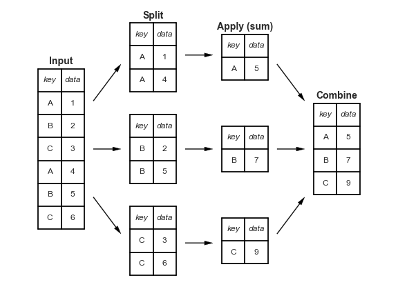

<!--BOOK_INFORMATION-->


*This notebook contains an excerpt from the [Python Data Science Handbook](http://shop.oreilly.com/product/0636920034919.do) by Jake VanderPlas; the content is available [on GitHub](https://github.com/jakevdp/PythonDataScienceHandbook).*

*The text is released under the [CC-BY-NC-ND license](https://creativecommons.org/licenses/by-nc-nd/3.0/us/legalcode), and code is released under the [MIT license](https://opensource.org/licenses/MIT). If you find this content useful, please consider supporting the work by [buying the book](http://shop.oreilly.com/product/0636920034919.do)!*

<!--NAVIGATION-->
< [Combining Datasets: Merge and Join](03.07-Merge-and-Join.md) | [Contents](Index.md) | [Pivot Tables](03.09-Pivot-Tables.md) >

<a href="https://colab.research.google.com/github/jakevdp/PythonDataScienceHandbook/blob/master/notebooks/03.08-Aggregation-and-Grouping.ipynb"></a>


# Aggregation and Grouping

An essential piece of analysis of large data is efficient summarization: computing aggregations like ``sum()``, ``mean()``, ``median()``, ``min()``, and ``max()``, in which a single number gives insight into the nature of a potentially large dataset.
In this section, we'll explore aggregations in Pandas, from simple operations akin to what we've seen on NumPy arrays, to more sophisticated operations based on the concept of a ``groupby``.

For convenience, we'll use the same ``display`` magic function that we've seen in previous sections:


```python
import numpy as np
import pandas as pd

class display(object):
    """Display HTML representation of multiple objects"""
    template = """<div style="float: left; padding: 10px;">
    <p style='font-family:"Courier New", Courier, monospace'>{0}</p>{1}
    </div>"""
    def __init__(self, *args):
        self.args = args
        
    def _repr_html_(self):
        return '\n'.join(self.template.format(a, eval(a)._repr_html_())
                         for a in self.args)
    
    def __repr__(self):
        return '\n\n'.join(a + '\n' + repr(eval(a))
                           for a in self.args)
```

## Planets Data

Here we will use the Planets dataset, available via the [Seaborn package](http://seaborn.pydata.org/) (see [Visualization With Seaborn](04.14-Visualization-With-Seaborn.md)).
It gives information on planets that astronomers have discovered around other stars (known as *extrasolar planets* or *exoplanets* for short). It can be downloaded with a simple Seaborn command:


```python
import seaborn as sns
planets = sns.load_dataset('planets')
planets.shape
```


    (1035, 6)


```python
planets.head()
```


                method  number  orbital_period   mass  distance  year
    0  Radial Velocity       1         269.300   7.10     77.40  2006
    1  Radial Velocity       1         874.774   2.21     56.95  2008
    2  Radial Velocity       1         763.000   2.60     19.84  2011
    3  Radial Velocity       1         326.030  19.40    110.62  2007
    4  Radial Velocity       1         516.220  10.50    119.47  2009


This has some details on the 1,000+ extrasolar planets discovered up to 2014.

## Simple Aggregation in Pandas

Earlier, we explored some of the data aggregations available for NumPy arrays (["Aggregations: Min, Max, and Everything In Between"](02.04-Computation-on-arrays-aggregates.md)).
As with a one-dimensional NumPy array, for a Pandas ``Series`` the aggregates return a single value:


```python
rng = np.random.RandomState(42)
ser = pd.Series(rng.rand(5))
ser
```


    0    0.374540
    1    0.950714
    2    0.731994
    3    0.598658
    4    0.156019
    dtype: float64


```python
ser.sum()
```


    2.8119254917081569


```python
ser.mean()
```


    0.56238509834163142


For a ``DataFrame``, by default the aggregates return results within each column:


```python
df = pd.DataFrame({'A': rng.rand(5),
                   'B': rng.rand(5)})
df
```


              A         B
    0  0.155995  0.020584
    1  0.058084  0.969910
    2  0.866176  0.832443
    3  0.601115  0.212339
    4  0.708073  0.181825


```python
df.mean()
```


    A    0.477888
    B    0.443420
    dtype: float64


By specifying the ``axis`` argument, you can instead aggregate within each row:


```python
df.mean(axis='columns')
```


    0    0.088290
    1    0.513997
    2    0.849309
    3    0.406727
    4    0.444949
    dtype: float64


Pandas ``Series`` and ``DataFrame``s include all of the common aggregates mentioned in [Aggregations: Min, Max, and Everything In Between](02.04-Computation-on-arrays-aggregates.md); in addition, there is a convenience method ``describe()`` that computes several common aggregates for each column and returns the result.
Let's use this on the Planets data, for now dropping rows with missing values:


```python
planets.dropna().describe()
```


              number  orbital_period        mass    distance         year
    count  498.00000      498.000000  498.000000  498.000000   498.000000
    mean     1.73494      835.778671    2.509320   52.068213  2007.377510
    std      1.17572     1469.128259    3.636274   46.596041     4.167284
    min      1.00000        1.328300    0.003600    1.350000  1989.000000
    25%      1.00000       38.272250    0.212500   24.497500  2005.000000
    50%      1.00000      357.000000    1.245000   39.940000  2009.000000
    75%      2.00000      999.600000    2.867500   59.332500  2011.000000
    max      6.00000    17337.500000   25.000000  354.000000  2014.000000


This can be a useful way to begin understanding the overall properties of a dataset.
For example, we see in the ``year`` column that although exoplanets were discovered as far back as 1989, half of all known expolanets were not discovered until 2010 or after.
This is largely thanks to the *Kepler* mission, which is a space-based telescope specifically designed for finding eclipsing planets around other stars.

The following table summarizes some other built-in Pandas aggregations:

| Aggregation              | Description                     |
|--------------------------|---------------------------------|
| ``count()``              | Total number of items           |
| ``first()``, ``last()``  | First and last item             |
| ``mean()``, ``median()`` | Mean and median                 |
| ``min()``, ``max()``     | Minimum and maximum             |
| ``std()``, ``var()``     | Standard deviation and variance |
| ``mad()``                | Mean absolute deviation         |
| ``prod()``               | Product of all items            |
| ``sum()``                | Sum of all items                |

These are all methods of ``DataFrame`` and ``Series`` objects.

To go deeper into the data, however, simple aggregates are often not enough.
The next level of data summarization is the ``groupby`` operation, which allows you to quickly and efficiently compute aggregates on subsets of data.

## GroupBy: Split, Apply, Combine

Simple aggregations can give you a flavor of your dataset, but often we would prefer to aggregate conditionally on some label or index: this is implemented in the so-called ``groupby`` operation.
The name "group by" comes from a command in the SQL database language, but it is perhaps more illuminative to think of it in the terms first coined by Hadley Wickham of Rstats fame: *split, apply, combine*.

### Split, apply, combine

A canonical example of this split-apply-combine operation, where the "apply" is a summation aggregation, is illustrated in this figure:


[figure source in Appendix](06.00-Figure-Code.md#Split-Apply-Combine)

This makes clear what the ``groupby`` accomplishes:

- The *split* step involves breaking up and grouping a ``DataFrame`` depending on the value of the specified key.
- The *apply* step involves computing some function, usually an aggregate, transformation, or filtering, within the individual groups.
- The *combine* step merges the results of these operations into an output array.

While this could certainly be done manually using some combination of the masking, aggregation, and merging commands covered earlier, an important realization is that *the intermediate splits do not need to be explicitly instantiated*. Rather, the ``GroupBy`` can (often) do this in a single pass over the data, updating the sum, mean, count, min, or other aggregate for each group along the way.
The power of the ``GroupBy`` is that it abstracts away these steps: the user need not think about *how* the computation is done under the hood, but rather thinks about the *operation as a whole*.

As a concrete example, let's take a look at using Pandas for the computation shown in this diagram.
We'll start by creating the input ``DataFrame``:


```python
df = pd.DataFrame({'key': ['A', 'B', 'C', 'A', 'B', 'C'],
                   'data': range(6)}, columns=['key', 'data'])
df
```


      key  data
    0   A     0
    1   B     1
    2   C     2
    3   A     3
    4   B     4
    5   C     5


The most basic split-apply-combine operation can be computed with the ``groupby()`` method of ``DataFrame``s, passing the name of the desired key column:


```python
df.groupby('key')
```


    <pandas.core.groupby.DataFrameGroupBy object at 0x117272160>


Notice that what is returned is not a set of ``DataFrame``s, but a ``DataFrameGroupBy`` object.
This object is where the magic is: you can think of it as a special view of the ``DataFrame``, which is poised to dig into the groups but does no actual computation until the aggregation is applied.
This "lazy evaluation" approach means that common aggregates can be implemented very efficiently in a way that is almost transparent to the user.

To produce a result, we can apply an aggregate to this ``DataFrameGroupBy`` object, which will perform the appropriate apply/combine steps to produce the desired result:


```python
df.groupby('key').sum()
```


         data
    key      
    A       3
    B       5
    C       7


The ``sum()`` method is just one possibility here; you can apply virtually any common Pandas or NumPy aggregation function, as well as virtually any valid ``DataFrame`` operation, as we will see in the following discussion.

### The GroupBy object

The ``GroupBy`` object is a very flexible abstraction.
In many ways, you can simply treat it as if it's a collection of ``DataFrame``s, and it does the difficult things under the hood. Let's see some examples using the Planets data.

Perhaps the most important operations made available by a ``GroupBy`` are *aggregate*, *filter*, *transform*, and *apply*.
We'll discuss each of these more fully in ["Aggregate, Filter, Transform, Apply"](#Aggregate,-Filter,-Transform,-Apply), but before that let's introduce some of the other functionality that can be used with the basic ``GroupBy`` operation.

#### Column indexing

The ``GroupBy`` object supports column indexing in the same way as the ``DataFrame``, and returns a modified ``GroupBy`` object.
For example:


```python
planets.groupby('method')
```


    <pandas.core.groupby.DataFrameGroupBy object at 0x1172727b8>


```python
planets.groupby('method')['orbital_period']
```


    <pandas.core.groupby.SeriesGroupBy object at 0x117272da0>


Here we've selected a particular ``Series`` group from the original ``DataFrame`` group by reference to its column name.
As with the ``GroupBy`` object, no computation is done until we call some aggregate on the object:


```python
planets.groupby('method')['orbital_period'].median()
```


    method
    Astrometry                         631.180000
    Eclipse Timing Variations         4343.500000
    Imaging                          27500.000000
    Microlensing                      3300.000000
    Orbital Brightness Modulation        0.342887
    Pulsar Timing                       66.541900
    Pulsation Timing Variations       1170.000000
    Radial Velocity                    360.200000
    Transit                              5.714932
    Transit Timing Variations           57.011000
    Name: orbital_period, dtype: float64


This gives an idea of the general scale of orbital periods (in days) that each method is sensitive to.

#### Iteration over groups

The ``GroupBy`` object supports direct iteration over the groups, returning each group as a ``Series`` or ``DataFrame``:


```python
for (method, group) in planets.groupby('method'):
    print("{0:30s} shape={1}".format(method, group.shape))
```

    Astrometry                     shape=(2, 6)
    Eclipse Timing Variations      shape=(9, 6)
    Imaging                        shape=(38, 6)
    Microlensing                   shape=(23, 6)
    Orbital Brightness Modulation  shape=(3, 6)
    Pulsar Timing                  shape=(5, 6)
    Pulsation Timing Variations    shape=(1, 6)
    Radial Velocity                shape=(553, 6)
    Transit                        shape=(397, 6)
    Transit Timing Variations      shape=(4, 6)


This can be useful for doing certain things manually, though it is often much faster to use the built-in ``apply`` functionality, which we will discuss momentarily.

#### Dispatch methods

Through some Python class magic, any method not explicitly implemented by the ``GroupBy`` object will be passed through and called on the groups, whether they are ``DataFrame`` or ``Series`` objects.
For example, you can use the ``describe()`` method of ``DataFrame``s to perform a set of aggregations that describe each group in the data:


```python
planets.groupby('method')['year'].describe().unstack()
```


                                   count         mean       std     min      25%  \
    method                                                                         
    Astrometry                       2.0  2011.500000  2.121320  2010.0  2010.75   
    Eclipse Timing Variations        9.0  2010.000000  1.414214  2008.0  2009.00   
    Imaging                         38.0  2009.131579  2.781901  2004.0  2008.00   
    Microlensing                    23.0  2009.782609  2.859697  2004.0  2008.00   
    Orbital Brightness Modulation    3.0  2011.666667  1.154701  2011.0  2011.00   
    Pulsar Timing                    5.0  1998.400000  8.384510  1992.0  1992.00   
    Pulsation Timing Variations      1.0  2007.000000       NaN  2007.0  2007.00   
    Radial Velocity                553.0  2007.518987  4.249052  1989.0  2005.00   
    Transit                        397.0  2011.236776  2.077867  2002.0  2010.00   
    Transit Timing Variations        4.0  2012.500000  1.290994  2011.0  2011.75   
    
                                      50%      75%     max  
    method                                                  
    Astrometry                     2011.5  2012.25  2013.0  
    Eclipse Timing Variations      2010.0  2011.00  2012.0  
    Imaging                        2009.0  2011.00  2013.0  
    Microlensing                   2010.0  2012.00  2013.0  
    Orbital Brightness Modulation  2011.0  2012.00  2013.0  
    Pulsar Timing                  1994.0  2003.00  2011.0  
    Pulsation Timing Variations    2007.0  2007.00  2007.0  
    Radial Velocity                2009.0  2011.00  2014.0  
    Transit                        2012.0  2013.00  2014.0  
    Transit Timing Variations      2012.5  2013.25  2014.0  


Looking at this table helps us to better understand the data: for example, the vast majority of planets have been discovered by the Radial Velocity and Transit methods, though the latter only became common (due to new, more accurate telescopes) in the last decade.
The newest methods seem to be Transit Timing Variation and Orbital Brightness Modulation, which were not used to discover a new planet until 2011.

This is just one example of the utility of dispatch methods.
Notice that they are applied *to each individual group*, and the results are then combined within ``GroupBy`` and returned.
Again, any valid ``DataFrame``/``Series`` method can be used on the corresponding ``GroupBy`` object, which allows for some very flexible and powerful operations!

### Aggregate, filter, transform, apply

The preceding discussion focused on aggregation for the combine operation, but there are more options available.
In particular, ``GroupBy`` objects have ``aggregate()``, ``filter()``, ``transform()``, and ``apply()`` methods that efficiently implement a variety of useful operations before combining the grouped data.

For the purpose of the following subsections, we'll use this ``DataFrame``:


```python
rng = np.random.RandomState(0)
df = pd.DataFrame({'key': ['A', 'B', 'C', 'A', 'B', 'C'],
                   'data1': range(6),
                   'data2': rng.randint(0, 10, 6)},
                   columns = ['key', 'data1', 'data2'])
df
```


      key  data1  data2
    0   A      0      5
    1   B      1      0
    2   C      2      3
    3   A      3      3
    4   B      4      7
    5   C      5      9


#### Aggregation

We're now familiar with ``GroupBy`` aggregations with ``sum()``, ``median()``, and the like, but the ``aggregate()`` method allows for even more flexibility.
It can take a string, a function, or a list thereof, and compute all the aggregates at once.
Here is a quick example combining all these:


```python
df.groupby('key').aggregate(['min', np.median, max])
```


        data1            data2           
          min median max   min median max
    key                                  
    A       0    1.5   3     3    4.0   5
    B       1    2.5   4     0    3.5   7
    C       2    3.5   5     3    6.0   9


Another useful pattern is to pass a dictionary mapping column names to operations to be applied on that column:


```python
df.groupby('key').aggregate({'data1': 'min',
                             'data2': 'max'})
```


         data1  data2
    key              
    A        0      5
    B        1      7
    C        2      9


#### Filtering

A filtering operation allows you to drop data based on the group properties.
For example, we might want to keep all groups in which the standard deviation is larger than some critical value:


```python
def filter_func(x):
    return x['data2'].std() > 4

display('df', "df.groupby('key').std()", "df.groupby('key').filter(filter_func)")
```


    df
      key  data1  data2
    0   A      0      5
    1   B      1      0
    2   C      2      3
    3   A      3      3
    4   B      4      7
    5   C      5      9
    
    df.groupby('key').std()
           data1     data2
    key                   
    A    2.12132  1.414214
    B    2.12132  4.949747
    C    2.12132  4.242641
    
    df.groupby('key').filter(filter_func)
      key  data1  data2
    1   B      1      0
    2   C      2      3
    4   B      4      7
    5   C      5      9


The filter function should return a Boolean value specifying whether the group passes the filtering. Here because group A does not have a standard deviation greater than 4, it is dropped from the result.

#### Transformation

While aggregation must return a reduced version of the data, transformation can return some transformed version of the full data to recombine.
For such a transformation, the output is the same shape as the input.
A common example is to center the data by subtracting the group-wise mean:


```python
df.groupby('key').transform(lambda x: x - x.mean())
```


       data1  data2
    0   -1.5    1.0
    1   -1.5   -3.5
    2   -1.5   -3.0
    3    1.5   -1.0
    4    1.5    3.5
    5    1.5    3.0


#### The apply() method

The ``apply()`` method lets you apply an arbitrary function to the group results.
The function should take a ``DataFrame``, and return either a Pandas object (e.g., ``DataFrame``, ``Series``) or a scalar; the combine operation will be tailored to the type of output returned.

For example, here is an ``apply()`` that normalizes the first column by the sum of the second:


```python
def norm_by_data2(x):
    # x is a DataFrame of group values
    x['data1'] /= x['data2'].sum()
    return x

display('df', "df.groupby('key').apply(norm_by_data2)")
```


    df
      key  data1  data2
    0   A      0      5
    1   B      1      0
    2   C      2      3
    3   A      3      3
    4   B      4      7
    5   C      5      9
    
    df.groupby('key').apply(norm_by_data2)
      key     data1  data2
    0   A  0.000000      5
    1   B  0.142857      0
    2   C  0.166667      3
    3   A  0.375000      3
    4   B  0.571429      7
    5   C  0.416667      9


``apply()`` within a ``GroupBy`` is quite flexible: the only criterion is that the function takes a ``DataFrame`` and returns a Pandas object or scalar; what you do in the middle is up to you!

### Specifying the split key

In the simple examples presented before, we split the ``DataFrame`` on a single column name.
This is just one of many options by which the groups can be defined, and we'll go through some other options for group specification here.

#### A list, array, series, or index providing the grouping keys

The key can be any series or list with a length matching that of the ``DataFrame``. For example:


```python
L = [0, 1, 0, 1, 2, 0]
display('df', 'df.groupby(L).sum()')
```


    df
      key  data1  data2
    0   A      0      5
    1   B      1      0
    2   C      2      3
    3   A      3      3
    4   B      4      7
    5   C      5      9
    
    df.groupby(L).sum()
       data1  data2
    0      7     17
    1      4      3
    2      4      7


Of course, this means there's another, more verbose way of accomplishing the ``df.groupby('key')`` from before:


```python
display('df', "df.groupby(df['key']).sum()")
```


    df
      key  data1  data2
    0   A      0      5
    1   B      1      0
    2   C      2      3
    3   A      3      3
    4   B      4      7
    5   C      5      9
    
    df.groupby(df['key']).sum()
         data1  data2
    key              
    A        3      8
    B        5      7
    C        7     12


#### A dictionary or series mapping index to group

Another method is to provide a dictionary that maps index values to the group keys:


```python
df2 = df.set_index('key')
mapping = {'A': 'vowel', 'B': 'consonant', 'C': 'consonant'}
display('df2', 'df2.groupby(mapping).sum()')
```


    df2
         data1  data2
    key              
    A        0      5
    B        1      0
    C        2      3
    A        3      3
    B        4      7
    C        5      9
    
    df2.groupby(mapping).sum()
               data1  data2
    consonant     12     19
    vowel          3      8


#### Any Python function

Similar to mapping, you can pass any Python function that will input the index value and output the group:


```python
display('df2', 'df2.groupby(str.lower).mean()')
```


    df2
         data1  data2
    key              
    A        0      5
    B        1      0
    C        2      3
    A        3      3
    B        4      7
    C        5      9
    
    df2.groupby(str.lower).mean()
       data1  data2
    a    1.5    4.0
    b    2.5    3.5
    c    3.5    6.0


#### A list of valid keys

Further, any of the preceding key choices can be combined to group on a multi-index:


```python
df2.groupby([str.lower, mapping]).mean()
```


                 data1  data2
    a vowel        1.5    4.0
    b consonant    2.5    3.5
    c consonant    3.5    6.0


### Grouping example

As an example of this, in a couple lines of Python code we can put all these together and count discovered planets by method and by decade:


```python
decade = 10 * (planets['year'] // 10)
decade = decade.astype(str) + 's'
decade.name = 'decade'
planets.groupby(['method', decade])['number'].sum().unstack().fillna(0)
```


    decade                         1980s  1990s  2000s  2010s
    method                                                   
    Astrometry                       0.0    0.0    0.0    2.0
    Eclipse Timing Variations        0.0    0.0    5.0   10.0
    Imaging                          0.0    0.0   29.0   21.0
    Microlensing                     0.0    0.0   12.0   15.0
    Orbital Brightness Modulation    0.0    0.0    0.0    5.0
    Pulsar Timing                    0.0    9.0    1.0    1.0
    Pulsation Timing Variations      0.0    0.0    1.0    0.0
    Radial Velocity                  1.0   52.0  475.0  424.0
    Transit                          0.0    0.0   64.0  712.0
    Transit Timing Variations        0.0    0.0    0.0    9.0


This shows the power of combining many of the operations we've discussed up to this point when looking at realistic datasets.
We immediately gain a coarse understanding of when and how planets have been discovered over the past several decades!

Here I would suggest digging into these few lines of code, and evaluating the individual steps to make sure you understand exactly what they are doing to the result.
It's certainly a somewhat complicated example, but understanding these pieces will give you the means to similarly explore your own data.

<!--NAVIGATION-->
< [Combining Datasets: Merge and Join](03.07-Merge-and-Join.md) | [Contents](Index.md) | [Pivot Tables](03.09-Pivot-Tables.md) >

<a href="https://colab.research.google.com/github/jakevdp/PythonDataScienceHandbook/blob/master/notebooks/03.08-Aggregation-and-Grouping.ipynb"></a>

